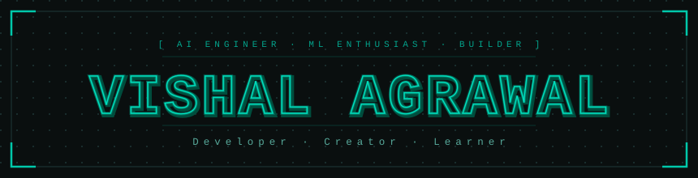

 

 

## ✦ About

> *Turning ambitious AI ideas into real, working products.*

|  |  |
|:--|:--|
| **Building** | Impactful AI products, from idea to deployment |
| **Collaborating on** | Machine Learning · Generative AI · Computer Vision |
| **Seeking help with** | Production-grade AI deployment and MLOps workflows |
| **Learning** | Deep Learning · LLM Engineering · System Design |
| **Ask me about** | Python · ML · Deep Learning · GenAI · DSA |

 

## ✦ Toolkit

| | |
|:--|:--|
| **Languages** |       |
| **ML / DL** |     |
| **Data** |       |
| **Cloud / MLOps** |   |

 

## ✦ Activity

 

✦ &nbsp; Building the future with AI &nbsp; ✦

